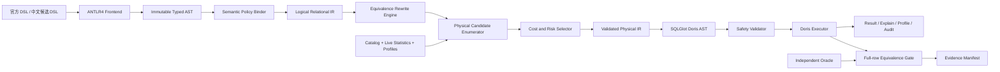
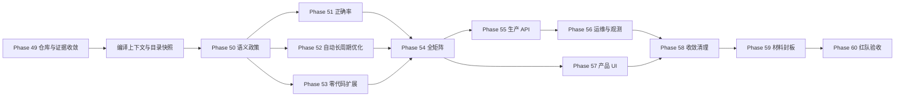

# FinDSL Forge 赛题满分与企业级产品全程开发路线

> 文档版本：1.1
> 制定日期：2026-08-09
> 适用项目：第五届中国研究生金融科技创新大赛赛题 19，行情选股 DSL 到高性能 Doris SQL 的自动化编译系统
> 当前基线分支：`feat/antlr-calcite-architecture`
> 本轮整理父基线：`75df7b85958575f3b9b25aafd213f58727d83d42`
> 文档角色：从当前状态持续指导开发、验证、产品化、提交和答辩，直至形成可审计的赛题满分候选交付与企业级产品基线

## 0. 文档定位与使用规则

这不是一份愿望清单，也不是按模块罗列的普通开发计划。它是项目后续工作的主控文档，负责回答五个问题：现在真正完成了什么；距离赛题硬指标还差什么；哪些算法已经得到验证，哪些只是项目自行约定；下一步应该按什么顺序改代码、跑数据、采证据；什么时候才有资格宣布某项任务完成。

后续新增的阶段设计、开发计划和验收报告都应引用本文。若局部阶段文档与本文冲突，必须先根据最新官方资料、代码和证据修订本文，再继续开发。不得为了让数字好看而绕开本文定义的统计口径。

项目事实的优先级固定如下：

1. 赛题方正式发布的题面、DSL 规范、数据表结构和后续书面答复；
2. 已审核并版本化的业务语义政策；
3. 当前 Git HEAD 对应的代码、测试、真实 Doris 结果和机器可读证据；
4. README、技术报告、手册、PPT、截图和口头说明。

文档只能解释事实，不能覆盖事实。若文档写着“已完成”，而当前 HEAD 没有对应测试或证据，则一律按未完成处理。

## 1. 总体结论

当前项目的技术方向正确，核心架构与赛题四项攻关任务高度一致。ANTLR4 前端、强类型 AST、Logical IR、规则优化器、Physical IR、SQLGlot Doris 后端、外部范围目录和真实 Doris 证据已经形成较完整的编译链路。该链路无需推倒重来。

但当前版本还不能直接宣称“赛题满分”或“企业级正式投产”。主要原因不在于功能数量不足，而在于四类关键闭环尚未完成：SQL 正确率没有统一的正式真值基准；20 年十倍加速尚未完全由编译器自动选路产生；新函数零代码扩展没有在正式主链路闭环；证据、报告、PPT 和当前代码 HEAD 仍有版本分裂。生产环境还缺少鉴权、资源治理、可观测性、高可用、备份恢复和配置发布治理。

当前状态应采用以下内部估计，不得将其写成官方分数：

| 维度 | 当前估计 | 说明 |
|---|---:|---|
| 核心编译架构完成度 | 90% 至 93% | 分层架构已形成，12 类函数均有新后端成功样本 |
| 赛题硬指标证据闭环 | 82% 至 87% | 编译和部分执行指标很强，正确率、自动优化和零代码函数仍需闭环 |
| 竞赛提交材料成熟度 | 70% 至 78% | 证据目录丰富，但技术报告、手册、PPT、截图存在旧口径 |
| 企业级生产准备度 | 72% 至 80% | 编译内核基础较好，服务治理和运维体系尚未完成 |

“满分”在本文中不是对评委评分结果的保证，而是一个工程状态：赛题每项要求都有明确实现、独立验证、真实环境指标、版本一致证据和可复现操作；不存在用迁移率冒充正确率、用手写 SQL 冒充编译器优化、用空结果冒充语义正确、用旧截图证明新版本等情况。

## 2. 官方目标与最终验收解释

### 2.1 四项技术任务

| 官方任务 | 本项目最终应交付的能力 |
|---|---|
| 高性能语义解析引擎 | ANTLR4/BNF 覆盖 12 类函数、复合逻辑、四则运算、区间、`then`、`limit`，输出可版本化强类型 AST |
| 逻辑等价重写模块 | 把 DSL 可靠降低为关系代数和 Doris SQL，自动生成 CTE、窗口、集合运算、时序状态、排名与聚合计划 |
| 声明式规则驱动框架 | 指标、字段、复权、表映射、函数模板、近似政策、范围政策和物理策略通过受控配置扩展 |
| 自适应查询优化器 | 为长周期查询枚举原始窗口、前缀差分、固定特征、物化视图和分区裁剪候选，按真实统计选择计划 |

### 2.2 五项量化指标

| 官方指标 | 工程验收口径 | 满分候选目标 |
|---|---|---|
| SQL 正确率不低于 95% | eligible 真值集上比较完整有序结果行，不比较 SQL 字符串 | 总体不低于 98%，每个函数族不低于 95%，无高严重度语义错误 |
| 19 年长周期加速不低于 10 倍 | 同一 DSL、同一快照、编译器生成的 baseline 与 optimized、关闭缓存、完整结果哈希一致 | 服务端和客户端端到端口径均达到 10 倍，且证据来自当前 HEAD |
| 新指标/新函数核心代码 0 行改动 | 冻结核心源码后只增加配置和测试数据，正式主链路完成编译与 Doris 执行 | 至少一个新指标、一个标量函数和一个窗口/事件模板完成盲扩展 |
| 编译 P95 小于 50ms | 从接收 DSL 到生成并验证 SQL 的端到端耗时，固定环境、足够样本 | P95 小于 25ms，P99 小于 50ms，当前官方复杂集不回退 |
| SQL 执行不高于 10s | eligible 查询真实 Doris P95，包含结果读取的端到端口径另行记录 | 全计划族矩阵 P95 小于 10s，常用交互查询 P95 小于 2s |

### 2.3 交付要求

最终提交必须具备可运行项目、清晰依赖、安装部署说明、技术文档、精益画布、原创性声明、Markdown 结果、工程效果图和决赛演示材料。所有提交目录必须有 `readme.txt`，压缩包应能在干净环境按文档复现。比赛统一测试首先检验能否运行，因此“本机能跑”不等于“可提交”。

## 3. 当前事实基线

### 3.1 Git 与持续集成

- 当前分支：`feat/antlr-calcite-architecture`；
- 当前 HEAD：`75df7b85958575f3b9b25aafd213f58727d83d42`；
- 本地工作区干净，远端同分支已同步；
- 对应 GitHub Actions 已通过 ANTLR 生成校验、Ruff 和 pytest；
- 当前正式快照记录 `1040 passed`、官方正例 `37/37`、负例 `37/37`。
- 本轮整理后的当前工作区全量测试为 `1042 passed`；该数字只证明本地代码回归通过，尚未替代正式 evidence 快照。

### 3.2 指标口径必须分开

| 指标 | 当前值 | 能证明什么 | 不能证明什么 |
|---|---:|---|---|
| strict ANTLR 解析 | `5792/5799` | 原始 DSL 在不修复条件下的严格语法通过数 | 不能写成 5799 条全部严格正确 |
| recovery 解析 | `5799/5799` | 7 条已知工作簿缺陷经可审计修复后均可解析 | 不能混入 strict 正确率 |
| recovery 槽位编译 | `1830/5799` | 旧适配器在恢复模式可生成结果的数量 | 不是新架构覆盖率，也不是正确率 |
| 新后端总成功 | `1076/5799` | ANTLR/IR/SQLGlot 主链路成功生成 SQL 的数量 | 失败中包含大量官方三表没有的数据域 |
| 旧严格成功集迁移 | `1044/1097`，`95.17%` | 新后端覆盖旧后端已确认能力的程度 | 绝不能称为 SQL 正确率 |
| readiness SQL fragment accuracy | `10/10` | 小型交付检查用例通过 | 样本过小，不能证明广泛正确性 |
| 独立参考行集 | 当前至少 `133/133` | 分散阶段中独立参考 SQL 与生成 SQL 完整哈希一致 | 尚未形成同 HEAD、冻结、分层的正式基准 |

新建的证据合同必须把上述指标写成不同字段，并在界面、报告和 PPT 中使用同一解释。

### 3.3 十二类函数现状

正式签名已经覆盖 `indicator`、`rank`、`belong_industry`、`queryData`、`cross_above`、`cross_down`、`close_together`、`reset`、`golden_cross`、`record_high`、`record_low`、`position`。Phase 48 漏斗中十二类均有新后端成功行，分别为 854、269、21、27、37、23、11、18、8、34、26、24。一个工作簿行可以包含多个函数，因此这些数字不能相加当作总成功数。

存在成功样本只证明该函数至少有一条可执行路径。最终验收仍需逐函数覆盖严格解析、类型检查、Logical IR、Physical IR、Doris SQL、非空执行、独立真值、错误诊断和性能边界。

### 3.4 已经形成的优势

1. 正式链路不依赖大模型直接生成 SQL；
2. ANTLR 解析、Typed AST、Logical IR、Physical IR 与 SQLGlot 后端职责清楚；
3. 缺少数据域或语义不确定时 fail-closed，不生成伪 SQL；
4. 关键范围数据保存来源、快照、成员数和哈希；
5. 多个阶段使用真实 Doris 完整结果行 SHA-256，而非只比行数；
6. 20 年官方数据已取得 `40.52x` 服务端和 `13.99x` 客户端性能证据；
7. Phase 48 新增成功问句 `23/23` 在 10 秒内完成；
8. Phase 6C 的 14 个前缀 Join 查询全部与直接特征列哈希一致且更快；
9. 测试、证据导出、Git 回溯和外部数据同步已具备较强工程基础。

### 3.5 当前最关键的不足

1. `40.52x` 脚本中的两条 SQL 仍是手写常量，优化服务表也没有进入正式 Physical Catalog；
2. `95.17%` 仍是迁移率，正式正确率尚未由统一真值集证明；
3. 正式函数签名硬编码在 Python 中，零代码函数扩展证据仍来自旧演示编译器；
4. `qfqMulti/qfqAdd` 已落表，但前复权规则未进入新后端表达式；
5. 排名并列、位置分档、粘合、回调、约等于和自然周期换算属于项目政策，尚未统一进入一个版本化语义合同；
6. 当前物理成本主要依赖静态逻辑字节，尚未充分利用 Doris 实时统计、选择率、内存、Shuffle 和历史 Profile；
7. 当前主 evidence HEAD 为 `96e0363`，迁移漏斗为 `6163f69`，长周期证据为 `1146cf0`，与当前 HEAD 不一致；
8. 中文手册、DOCX/PDF、技术报告、PPT、截图和视频统一延后到核心功能与证据闭环完成后刷新，当前不在展示材料上消耗开发时间；
9. Docker Desktop 在最近一次检查时未运行，不能把历史 Doris 快照当作当前在线健康状态；
10. Demo 服务适合答辩，不具备完整生产服务治理。

### 3.6 官方 5799 条语料的根因分类

后续不能再把 5799 条工作簿记录理解为 5799 个需要逐条修补的功能。按 Phase 48 漏斗中的终止错误重新分类后，当前事实为：

| 分类 | 行数 | 占比 | 工程含义 |
|---|---:|---:|---|
| 已通过 | 1076 | 18.56% | 新后端已经生成受控 SQL，保持回归即可。 |
| 数据不可用 | 4082 | 70.39% | 依赖官方三表未提供的数据域，或缺少完整、版本化的成员关系；不能靠编译器猜测。 |
| 非法输入 | 104 | 1.79% | 类型、词法或语法本身无效；严格模式应稳定拒绝。 |
| 可开发能力缺口 | 537 | 9.26% | 主要集中在通用约束、日期、事件周期、时序范围和排名表达式。 |

旧严格成功集的剩余迁移缺口为 53 条，终止码均为 `PHYSICAL_SCOPE_DATA_UNAVAILABLE`。这些记录包含 57 个范围目标、76 次出现，不能等价理解为 53 个编译器算法缺陷。对可获得完整定义的行业、指数、ETF 或概念成员，应通过版本化 Provider 补齐；对事件型范围、疑似噪声名称、境外资产或只有当前截面而无历史成分的数据，应返回结构化诊断，等待官方确认或明确采用的业务 profile。

机器可读分类由 `src/findsl/official_gap_analysis.py` 生成，当前报告为 `reports/current_official_gap_taxonomy.json/.md`。该分析器把开发门禁写成 `unit=capability_cluster`、`row_level_patches_allowed=false`，防止项目重新回到逐行打补丁。

### 3.7 本轮架构复核结论

当前方向正确，但现状还不是实现层面的最优形态。最优选择不是推倒重写，也不是继续逐句修补，而是“保留已验证编译资产，尽快完成架构收敛”：

1. ANTLR、Typed AST、Domain Model、Logical IR、Physical IR 和 SQLGlot 后端继续作为正式主线；
2. 旧管道降为只读兼容和差分基线，禁止正式核心反向调用旧模块；
3. 将编译期配置、目录、统计和政策冻结为 `CompileContext/CatalogSnapshot`，避免全局状态和版本漂移；
4. 把业务语义与通用关系代数彻底分开，优先把新增能力降低为正交关系算子；
5. 把固定顺序 RBO 升级为“等价规则产生候选 + 轻量 memo 去重 + 成本/风险选择”，同时复用 Doris Nereids 和统计能力；
6. 将超大 `physical/planner.py`、Doris backend 和 validator 按职责拆分，但每次拆分必须行为等价、可回滚；
7. 以正式正确率真值集和分层性能矩阵驱动开发，不再以总编译数字驱动。

本轮已经完成第一道架构防线：共享错误和字面量从 `official_slot.py` 迁入官方包，新 pipeline 的指标解析改用官方 Registry，手写前端和双前端差分迁入 `findsl.compat`，`import-linter` 禁止整个 `findsl.official` 包依赖旧 `official_slot`、`compiler`、`parser`、`semantic` 和 `sqlgen`。此约束已分析 118 个模块、325 条依赖并通过，且进入 CI。详细决定见 `docs/adr/0001-官方编译器主线与兼容层边界.md`。

## 4. 不可违反的工程原则

### 4.1 正确性优先

- 不得把编译成功率、迁移率、语法通过率或无异常率称为 SQL 正确率；
- 不得把 `1=0`、空结果或固定占位结果计为语义成功；
- 不得因为新旧后端一致就认定二者都正确，必须有独立真值；
- 不得让 oracle 调用被测编译器的 SQL 生成逻辑；
- 不得把 recovery 修复用例混入 strict 分母；
- 不得为提升 5799 总成功数而接入不完整、不可版本化或语义模糊的数据。

### 4.2 优化必须保持等价

每条优化规则必须包含适用条件、前置假设、证明义务、前后 IR 哈希和反例测试。规则只负责产生等价候选，成本模型负责选择候选。该分工与 Calcite 的关系代数和规则规划原则一致。

### 4.3 证据必须版本一致

证据文件必须记录 Git HEAD、配置指纹、官方工作簿 SHA-256、数据快照 ID、Doris 版本、表行数、统计更新时间、执行参数和生成时间。最终汇总若引用不同 HEAD 的历史结果，必须标记为历史参考，不能进入当前总分结论。

### 4.4 性能实验必须可复核

- baseline 与 optimized 必须来自同一 DSL 和同一编译器；
- 正式计时关闭并反查 SQL Cache；
- 查询顺序交替，包含预热并保留冷启动数据；
- 至少记录 P50、P95、P99、最小值、最大值和样本数；
- 比较完整结果行哈希，不只比较 `COUNT(*)`；
- 保存 EXPLAIN、Query Profile、扫描分区、扫描行、扫描字节、CPU、峰值内存和 Shuffle；
- 不得用模型估算字节冒充 Doris 实测 I/O。

### 4.5 生产行为必须显式

所有默认值都要有版本和来源。范围别名、形态阈值、排名并列、复权方式、时间换算、空值处理和数据新鲜度都不能藏在代码分支里。任何未定义语义必须返回稳定诊断，不能猜测。

## 5. 目标架构



### 5.1 编译数据面

数据面只处理一次请求所需的解析、绑定、优化、SQL 生成和执行。它必须是确定性的，不访问任意外部网络，不读取未固定版本的分类数据，不允许 LLM 输出绕过类型和安全检查。

### 5.2 规则与目录控制面

控制面管理函数签名、指标、物理表达式、资源、统计、策略、业务政策和数据快照。所有配置必须经过 JSON Schema 和语义校验，发布时生成统一 catalog fingerprint。运行请求只能引用已发布版本。

### 5.3 证据面

证据面独立于在线请求，负责生成正确率、性能、数据治理、扩展性、代码质量和 UI 验收证据。证据面不得修改生产配置，也不得把手工挑选结果写回编译器。

### 5.4 服务面

竞赛 Demo 与生产 API 共享同一应用服务层，不直接复制编译逻辑。建议在现有 Python 技术栈上引入 FastAPI/Pydantic，并由 Uvicorn 承载。竞赛离线包可保持单进程，生产部署再启用多 worker 或容器编排。鉴权、审计、限流和请求预算必须位于执行入口之前。

### 5.5 新旧管线收敛

旧管线短期继续承担兼容入口、内部 FinDSL 样例和迁移差分，不再新增官方业务能力，也不能作为独立真值 oracle。依赖方向固定为“兼容层可以调用新核心，新核心不得调用兼容层”。共享类型只能进入中性公共模块或官方包，不能继续从 `official_slot.py` 私有函数中借用。

收敛分四步完成：

1. **依赖隔离**：用 import-linter 禁止正式官方核心依赖旧解析、语义和 SQL 生成模块；本轮已完成第一版门禁。
2. **入口统一**：CLI、API、Demo、证据脚本和提交包统一调用 `compile_official` 应用服务；旧入口改为薄 facade 并输出弃用信息。
3. **行为证明**：正式正确率、12 类函数矩阵、零代码扩展、自动长周期优化和连续两个版本 P0/P1 回归门禁通过。
4. **物理归档**：调用图确认无产品入口依赖后，再把旧实现移动到只读兼容包或 `archive/legacy_compiler/`。该动作单独提交，保留可回滚路径。

在第三步完成之前，不通过大规模移动代码来制造“已经解耦”的表象；在第一步完成之后，也不允许继续给旧管道增加新能力。

## 6. 业务语义政策设计

### 6.1 统一政策文件

新增 `configs/official/semantic_policies.json` 和对应 Schema，至少包含：

- `rank_tie_policy`：`row_number`、`rank` 或 `dense_rank`；
- `price_adjustment`：股票、指数、基金等资产的复权方式与公式；
- `period_sessions`：周、月、季度、年的交易观测换算；
- `approximation`：不同类型的相对/绝对误差；
- `position_buckets`：五档阈值与极值优先级；
- `technical_patterns`：粘合、回调等阈值；
- `null_policy`：空值是否排除、保留或诊断；
- `calendar_anchor`：跨资源查询使用哪一份交易日历；
- `scope_effective_date_policy`：当前成员、历史成员和不可回溯范围的处理；
- `policy_id`、`version`、`effective_from`、`review_status`、`source` 和 `rationale`。

### 6.2 排名政策

当前使用 `ROW_NUMBER` 并以证券稳定键打破并列，这能保证“前 10”严格返回不超过 10 条，适合作为竞赛默认。由于官方未明确并列处理，必须将其改成可配置政策，并新增以下用例：全相同值、边界并列、空值、百分比排名、升序/降序、阶段内排名、行业内排名。答辩时应说明默认政策及可替换性。

### 6.3 复权政策

正式实现不得只保留字段。建议将股票前复权定义为受控表达式候选：

```text
adjusted_price = raw_price * qfqMulti + qfqAdd
```

指数默认不复权，其他资产类型按配置选择。必须由官方回复或数据说明确认公式后才能标记 approved。实现需覆盖开、高、低、收、最新价以及基于价格的均线、收益率、穿越、极值和位置。原始价和复权价要作为不同 Logical Field，不能在 SQL 生成末端临时替换。

### 6.4 时间政策

当前 5/20/60/250 个有效交易观测是合理工程默认，但不是不可变行业定律。必须区分：

- 日历区间，如“近三个月”，按日历边界裁剪；
- 事件观察窗，如“60 日新高”，按每只证券有效交易观测；
- 财报周期，按报告期而不是日线近似；
- `count_exp` 的周/月/季/年，按时间桶统计而不是简单乘交易日；
- 查询日与窗口预热行，过滤输出日期但保留计算历史。

### 6.5 形态政策

`close_together=3%`、`reset near=2%`、`reset below=0.5%`、`position=0.25/0.75` 和 `~=` 的 1%/0.01 规则均应视为可替换业务政策。配置必须带版本、依据和风险等级，报告不得称其为官方唯一定义。若赛题方未回复，使用项目默认 profile，同时在技术报告中单列假设。

### 6.6 范围和外部数据政策

公共或第三方数据只有在以下条件全部满足时才可进入正式范围目录：来源可说明；成员列表完整；抓取日期和原始响应可保存；成员数有合理上下界；许可允许比赛使用；别名映射经过人工审核；历史日期查询不会被当前截面误导。缺少历史成分时，当前成员只能用于当前截面问句，历史问句应返回风险诊断或使用明确的 current-membership profile。

## 7. 核心算法最终方案

### 7.1 ANTLR4 前端

`OfficialSlot.g4` 继续作为唯一正式语法来源，生成文件由 CI 校验。函数名可以由通用 `IDENT` 解析，但可接受函数及参数约束必须来自版本化函数目录。严格模式不得自动修复输入；恢复模式只允许白名单修复，并返回原文、标准化文本、修复列表和风险级别。

需要新增语法属性测试：随机合法 AST 往返、无效 token、括号深度、超长输入、Unicode 混淆、引号转义、运算优先级、`between` 开闭区间和 `then` 限制。解析器需要配置最大输入长度、最大节点数和最大嵌套深度，防止资源耗尽。

### 7.2 Typed AST 与语义绑定

AST 必须不可变并携带源位置。语义层只负责类型、函数签名、槽位约束和政策引用，不选择物理表。所有 `unknown` 类型必须在进入 Physical IR 前消除或失败。函数调用绑定应保存 function catalog version，避免运行时配置变化后无法解释历史计划。

### 7.3 Logical IR

Logical IR 只表达业务语义，不包含数据库名、表名和 SQL 片段。继续优先复用 `Scan`、`Filter`、`Project`、`Aggregate`、`Join`、`SetOperation`、`Window`、`Rank`、`Stage`、`Temporal` 等正交节点。新增能力优先重写为已有关系算子，只有无法表达的领域语义才增加节点。

### 7.4 等价规则

每条规则定义：`rule_id`、版本、匹配条件、变换、证明义务、反例和可禁用开关。规则测试至少包括原计划与优化计划的 reference 结果一致、规则幂等、顺序变化不改变最终语义、禁用后可回退。不得把成本判断写进等价规则。

### 7.5 物理候选与成本模型

物理规划器为同一 Logical IR 枚举多个合法候选，而不是遇到第一个可用策略立即返回。长窗口至少包含：

1. 原始窗口函数；
2. 前缀累计值差分；
3. 集合式 prefix CTE/Join；
4. 固定窗口特征列；
5. 分区化 rollup 服务表；
6. Doris 同步或异步物化视图；
7. 不满足新鲜度时回退原始表。

滚动求和和平均的核心公式为：

```text
rolling_sum(t, N) = prefix_sum(t) - prefix_sum(t-N)
rolling_count(t, N) = prefix_count(t) - prefix_count(t-N)
rolling_avg(t, N) = rolling_sum(t, N) / NULLIF(rolling_count(t, N), 0)
```

成本不能只使用静态表字节。建议使用可解释向量：扫描字节、预计输出行、Shuffle 字节、排序行数、窗口宽度、CPU、峰值内存、候选新鲜度、历史 P95 和风险罚分。最终标量只用于排序，原始分量必须保留在 explain 中。Doris `ANALYZE`、`SHOW TABLE STATS`、`SHOW COLUMN STATS` 与 audit/profile 负责更新统计。统计健康度不足时不得声称成本选择最优。

### 7.6 SQLGlot Doris 后端

所有正式 SQL 继续由 AST 渲染。禁止把配置中的任意 SQL 字符串直接拼入查询；配置表达式只能使用受控操作符代数。后端必须执行单 SELECT 限制、表/列白名单、无 DDL/DML、无注释逃逸、窗口位置合法、稳定排序和 Doris 方言往返校验。

### 7.7 独立真值系统

正式 oracle 分三层：

1. 小数据 Pandas/SQLite reference，用于快速单元回归；
2. 人工编写的 Doris reference SQL，用于官方真实数据完整行集比较；
3. 代数属性和变形测试，例如条件交换、范围等价、baseline/optimized 等价。

参考 SQL 不复用被测 planner、renderer 或生成 SQL 片段。每条真值用例记录作者、复核人、业务解释、数据依赖和预期非空性。空结果允许存在，但不能作为唯一正确性证据。

### 7.8 AI 辅助边界

AI 只负责把自然语言转换为一个或多个 DSL 候选、解释诊断和生成文档草稿。候选必须经过同一编译器。模型不得直接获得 Doris 写权限，不得输出 SQL 后绕开 validator，不得参与正式 oracle。离线无模型模式必须完整可运行，保证比赛环境不依赖外部 API。

## 8. 分阶段开发路线

本路线从当前 Phase 48 后继续编号。阶段编号表达依赖顺序，不要求机械地一次只修改一个文件，但后续阶段不得绕过前置门禁。竞赛硬指标阶段优先于产品包装，正确性优先于继续扩大可编译数字。

从本版起停止“发现一条失败语句、追加一个特判、再继续找下一条”的工作方式。每个开发任务必须对应一个能力簇、一个明确层级和一组批量回归用例。只有通用规则已经存在、但个别已审核别名或数据成员缺失时，才允许修改数据目录；即使如此，也只能添加带来源和版本的目录记录，不能按行号编码。

## Phase 49：仓库收敛、缺口聚类与统一事实基线

### 目标

先让仓库重新拥有唯一主线和单向依赖，再消除 strict、recovery、slot compile、new backend、migration、correctness 和 performance 之间的混用，使所有当前结论可以追溯到同一 HEAD。

### 设计选择

证据合同使用显式 Schema，而不是在 Markdown 中约定字段。所有比例同时保存分子、分母、集合定义和生成器版本。current 证据与 historical 证据分目录或分 manifest 节点管理，不覆盖历史文件，也不允许历史文件自动进入当前汇总。

### 主要任务

1. 将当前开发路线固定为 `docs/00_当前开发主线.md`，阶段报告和旧计划移入 `docs/history/`；
2. 记录 ADR-0001，明确官方核心、兼容 facade 和旧管道的依赖方向；
3. 迁出 `official_slot.py` 中被新核心复用的错误与字面量逻辑，增加 import-linter CI 门禁；
4. 生成 5799 条能力聚类报告，固定 1076 已通过、4082 数据不可用、104 非法输入、537 能力缺口；
5. 新增机器可读 `configs/official/evidence_contract.json` 与 Schema；
6. 在 `src/findsl/evidence_metadata.py` 增加字段定义、分母和来源校验；
7. evidence exporter 检查所有 current 文件的 `git_head` 一致；
8. 历史证据移动到 manifest 的 `historical` 分组，不删除文件；
9. 正式汇总明确 strict 5792、recovery 5799、slot 1830、新后端 1076、迁移 1044/1097；
10. readiness 检测活动文档中的旧指标，如 `203 passed`、`311 passed`；
11. 启动 Doris 后重新运行基础健康、行数、统计、测试和证据导出；
12. 让 Web Demo 只读取 metadata，不在前端代码内写死数字；
13. 输出一份“指标词典”，解释每项指标能证明和不能证明什么。

### 建议文件

```text
configs/official/evidence_contract.json
configs/official/evidence_contract.schema.json
docs/adr/0001-官方编译器主线与兼容层边界.md
src/findsl/evidence_metadata.py
src/findsl/official_gap_analysis.py
src/findsl/readiness.py
scripts/analyze_official_gaps.py
scripts/export_submission_artifacts.ps1
tests/test_evidence_metadata.py
tests/test_official_gap_analysis.py
tests/test_readiness.py
submission_artifacts/evidence_manifest.md
```

### 测试与证据

- 正式官方核心到旧管道的 forbidden import contract；
- 能力分类总数必须等于 5799，分类互斥且计数稳定；
- 元数据 Schema 测试；
- 混合 HEAD 必须失败；
- 缺少数据快照 ID 必须失败；
- 迁移率被写入 correctness 字段必须失败；
- 旧数字出现在活动交付文档时 readiness 给出阻塞错误；
- 当前 HEAD、工作簿 SHA、配置 fingerprint、Doris 版本统一写入 manifest。

### 完成标准

`evidence_metadata.json`、summary、README 顶部、Web Demo、技术报告和 PPT 使用同一组当前数据；warning count 为 0；历史结果不再被误当作当前结果。当前 evidence 包必须可以从空 `reports/` 目录重新生成。

### 当前进度

- [x] 文档主线与历史区分离；
- [x] ADR-0001 和依赖防回退门禁；
- [x] 官方核心共享错误、字面量与指标解析解耦；
- [x] 5799 条能力聚类工具、报告和回归测试；
- [x] evidence contract Schema、指标类型约束与同 HEAD 强校验；
- [ ] Doris 当前环境重采和全部材料刷新。

当前证据合同已能阻止混合 HEAD、缺失数据快照以及把迁移率误写为正确率。真实 Doris 重采安排在优化器与正式基准冻结之后一次完成，避免核心代码持续变化期间反复装载和采集同一批数据。

### 预计工作量

2 至 3 个集中开发日。

## Phase 50：业务语义政策冻结

### 目标

把所有可能产生“SQL 稳定但业务口径错误”的默认值移出代码，形成可审计、可替换的比赛 profile。

### 主要任务

1. 建立统一 semantic policy Schema；
2. 迁移排名并列、近似、位置分档、粘合和回调阈值；
3. 实现股票前复权、指数不复权的 Logical Field 和 Physical Expression；
4. 区分日历区间、交易观测窗口和财报周期；
5. 固定 NULL、停牌、上市前空窗、除零和数据延迟规则；
6. 给所有范围和指数政策增加生效日期及历史可用性；
7. 把待赛题方确认的问题标记为 `provisional`，禁止包装为官方定义；
8. 生成政策变更影响报告，列出受影响函数、指标、用例和结果哈希；
9. 在 Physical IR 中保留 policy ID，不把政策说明拼入 SQL。

### 建议文件

```text
configs/official/semantic_policies.json
configs/official/semantic_policies.schema.json
src/findsl/official/policy.py
src/findsl/official/domain/binder.py
src/findsl/official/physical/expressions.py
src/findsl/official/physical/planner.py
tests/official/test_semantic_policies.py
tests/official/physical/test_adjustment.py
```

### 核心验收用例

- 原始价格与前复权价格在复权因子不为 1 时结果不同；
- 指数明确不使用股票复权因子；
- 排名边界出现并列值时按选定 policy 返回稳定结果；
- `position` 在最小值等于最大值时不除零；
- 交易月与自然月规则不互相替代；
- 历史日期引用只有当前成员的范围时返回明确风险或拒绝；
- 修改政策版本后 plan ID 和 evidence 明确变化。

### 完成标准

相同 DSL、相同政策版本和数据快照产生相同 plan ID 与结果；替换政策只改变应受影响的计划；政策缺失时明确失败；所有默认值可以在一个文档和一个 JSON 中查到。

### 当前进度

- [x] 建立编译器 manifest、不可变 `CatalogSnapshot` 和请求级 `CompileContext`；
- [x] 排名、空值、除零、日历和复权声明进入版本化语义政策；
- [x] plan ID 绑定目录指纹、政策版本和编译选项；
- [x] 编译期间配置漂移与目录越界读取可被拒绝；
- [ ] 在真实 Doris 数据上完成前复权差异、历史范围有效期和政策变更影响证据。

### 预计工作量

3 至 5 个集中开发日。

## Phase 51：正式 SQL 正确率基准

### 目标

建立能够真正支撑“SQL 正确率不低于 95%”的冻结基准，不再借用迁移率。

### 样本设计

建议至少 240 条 eligible 正例和 120 条负例：

- 12 类函数每类至少 12 条独立正例；
- `then`、集合、四则运算、between、limit、聚合、count_exp 各至少 12 条；
- 精确日期、相对日期、跨年、窗口预热、停牌、空值和除零边界；
- 单表、多表、外部范围、指数标量和阶段排名；
- 固定窗口、任意窗口、长周期和复杂嵌套；
- 每类同时包含非空结果、小结果集和大结果集。

样本从官方 5799 条中按函数族和计划族分层抽取，另外加入人工边界用例。不得只选择已经成功的简单行。eligible 判定必须独立于被测编译器，明确区分官方三表缺域、语法缺陷、业务口径未定义和真正实现缺口。

### 真值建设流程

1. 先写自然语言语义解释和期望数据域；
2. 独立作者编写 reference SQL，不查看 generated SQL；
3. 第二人或独立审查流程复核日期、窗口、范围、空值和并列；
4. 在固定 Doris 快照执行 reference SQL，保存结果行数与哈希；
5. 再执行生成 SQL，计算 missing/extra 和完整哈希；
6. 每次政策或数据版本变化时只更新受影响用例，并保留旧版本；
7. 评委可直接从 case ID 找到 DSL、reference、generated、result 和解释。

### 建议数据结构

```json
{
  "case_id": "CORR-RANK-001",
  "dsl": "...",
  "functions": ["rank"],
  "plan_family": "stage_rank",
  "eligibility": "eligible",
  "policy_version": "competition-v1",
  "snapshot_ids": ["..."],
  "expected_non_empty": true,
  "reference_sql_path": "...",
  "review_status": "approved"
}
```

### 评分公式

```text
correctness = 完整行集完全一致的 eligible 用例数 / eligible 用例总数
```

同时报告函数族、计划族、日期类型和结果规模的分层正确率，并给出 Wilson 或 Clopper-Pearson 置信区间。总体达到 95%但某一函数族明显失效，不得宣称全面完成。

### 建议文件

```text
data/official_correctness/manifest.jsonl
data/official_correctness/reference_sql/
scripts/build_official_correctness_benchmark.py
scripts/run_official_correctness_benchmark.py
src/findsl/official/correctness.py
reports/official_correctness_benchmark.json
reports/official_correctness_benchmark.md
tests/test_official_correctness_contract.py
```

### 完成标准

当前 HEAD 在冻结集上总体不低于 98%，每个函数族不低于 95%，无 P0/P1 语义错误；所有 reference SQL 经过独立复核；完整结果哈希、缺失行和额外行均可查看。测试集版本、数据快照和政策版本固定。

### 当前进度

- [x] 完成 eligible/approved 分母合同、独立 reference SQL 执行器、完整行集哈希与 Wilson 区间；
- [x] 总体及函数族、计划族分层报告和失败明细已机器化；
- [ ] 建立并独立复核至少 240 条正式 eligible 正例；
- [ ] 在冻结 Doris 快照运行正式基准并达到总体 98%、各函数族 95% 的内部目标。

### 预计工作量

5 至 8 个集中开发日，人工语义复核可能成为关键路径。

## Phase 52：编译器自适应长周期优化闭环

### 目标

让 `40.52x` 和 `13.99x` 真正成为编译器能力，而不是手写 benchmark SQL 的数据库能力。

### 主要任务

1. 将 `hsj_stock_hq_basic_rollup` 加入 `physical_catalog.json`；
2. 为 `volume_sum_5`、`volume_sum_20`、`turnover_sum_20` 建立受控特征定义；
3. 把 rollup、prefix、direct、window 建成同一 Logical Aggregate 的物理候选；
4. 从 Doris 采集行数、列统计、分区、NDV、空值和历史 Profile；
5. 引入新鲜度和统计健康度门禁；
6. 增加 `auto`、`force_baseline`、`force_candidate` 三种仅用于验证的策略模式；
7. 证据脚本输入 DSL，由编译器分别生成 baseline 和 optimized SQL；
8. 重新验证 20 年完整结果哈希、EXPLAIN 分区和 Query Profile；
9. 扩展到 SUM、AVG、价格均线和成交量均线，不把单一用例泛化为所有查询；
10. 记录候选未选中的原因，包括成本、新鲜度、统计健康度和语义能力。

### 成本模型实施顺序

第一版使用保守可解释模型，不追求一次实现完整 Volcano：

```text
cost = scan_bytes
     + shuffle_weight * estimated_shuffle_bytes
     + sort_weight * estimated_sort_rows
     + memory_weight * estimated_peak_memory
     + latency_weight * calibrated_p95
     + freshness_penalty
     + risk_penalty
```

权重由真实 Profile 校准，配置带版本。若统计缺失，候选可进入 shadow，但不能自动 active。长期可逐步引入等价表达 memo 和动态规划，不应在竞赛冲刺阶段盲目重写完整优化器。

### 建议文件

```text
configs/official/physical_catalog.json
configs/official/physical_strategies.json
configs/official/physical_statistics.json
src/findsl/official/physical/planner.py
src/findsl/official/physical/statistics.py
src/findsl/official/backend/doris.py
scripts/collect_compiler_long_horizon_evidence.py
tests/official/physical/test_long_horizon_planner.py
```

### 完成标准

同一 DSL 在 `auto` 下自动选择加速候选；baseline/optimized 均可追溯到 Physical IR；官方 20 年数据完整结果一致；服务端与客户端口径均达到 10 倍；统计过期时安全回退；benchmark 中不再保存手写 generated SQL 常量。

### 预计工作量

4 至 7 个集中开发日。

## Phase 53：正式主链路零代码扩展

### 目标

在 ANTLR/Typed AST/Logical IR/Physical IR/SQLGlot 主链路证明新指标和新函数仅改配置。

### 最佳实现方式

新增 schema-validated function catalog，不允许任意 SQL 模板。函数按有限模板类别扩展：

- `numeric_scalar`：ABS、取整、截断等纯标量；
- `numeric_binary`：安全比值、差值、归一化；
- `aggregate`：受控 SUM/AVG/MIN/MAX；
- `window_aggregate`：固定或参数化窗口；
- `boolean_event`：当前/前值关系模板；
- `range_classifier`：受控分档；
- `relation_template`：由既有 Logical IR 节点组合的关系模板。

真正全新、无法由既有代数表达的语义仍需要新增核心算子。赛题的“零代码”应解释为在已支持模板协议内零侵入，而不是声称任意未知算法都能靠 JSON 发明。

### 函数目录要求

每个函数声明名称、别名、槽位、参数类型、返回类型、纯函数属性、允许的模板类别、Logical IR 构造、Physical capability、reference operator、安全约束和版本。模板只能引用命名参数和受控操作符，不能包含任意 SQL 文本或 Python 表达式。

### 盲扩展验收

1. 记录扩展前核心源码树 SHA-256；
2. 仅增加临时配置、样本列和测试夹具；
3. 加入一个新指标、一个标量函数、一个窗口或事件函数；
4. 完成 strict parse、typed、logical、physical、SQL、Doris、reference；
5. 记录扩展后核心源码树 SHA-256，必须一致；
6. 删除临时 fixture 后项目恢复原状；
7. 把操作过程录入 evidence，证明没有隐藏修改核心代码。

### 建议文件

```text
configs/official/functions.json
configs/official/functions.schema.json
src/findsl/official/function_catalog.py
src/findsl/official/template_lowering.py
tests/official/test_config_only_function_extension.py
scripts/collect_zero_code_extension_evidence.py
reports/zero_code_extension_evidence.json
```

### 预计工作量

4 至 6 个集中开发日。

### 当前进度

- [x] 正式主链路已支持受控的数值标量、数值二元和布尔事件模板；
- [x] 新指标与新函数盲扩展测试证明核心源码树哈希保持不变；
- [x] 任意 SQL 模板和任意 Python 表达式被目录 Schema 与加载器拒绝；
- [ ] 补齐窗口模板，并在真实 Doris 上生成可提交的零代码扩展证据。

## Phase 54：十二类函数全链路与全计划族性能矩阵

### 目标

消除“函数名能解析但深层计划没有验证”的风险，并把 10 秒证据从 6 条扩展为代表性矩阵。

### 矩阵字段

每条用例记录函数族、复合算子、Logical IR、Physical Strategy、资源、数据日期、结果行数、结果哈希、compile P50/P95/P99、execute P50/P95/P99、EXPLAIN 摘要、扫描分区、扫描行、扫描字节、峰值内存、是否命中缓存和状态。

性能用例至少覆盖：普通扫描、派生表达式、多表 Join、集合范围、行业聚合、queryData 标量、rank、stage rank、temporal count、crossing、extreme、position、prefix join、rollup、长周期 window。每类至少包含轻、中、重三个负载档位。

### 测量规则

- 每条至少 1 次预热和 7 次正式执行；
- 冷启动数据与稳态数据分别报告；
- 查询顺序随机或交替，禁止固定让某候选永远后执行；
- 保存 query ID 和完整 Profile；
- 同一行集哈希不一致时立即停止性能比较；
- P95 超过 10 秒为阻塞，超过 8 秒为高风险；
- 结果全空的查询不能成为该计划族唯一证据。

### 建议文件

```text
data/official_performance/matrix.jsonl
scripts/run_official_performance_matrix.py
src/findsl/official/performance.py
reports/official_full_performance_matrix.json
reports/official_full_performance_matrix.md
tests/test_official_performance_contract.py
```

### 完成标准

所有 12 类函数至少一条非空真实 Doris 独立真值；所有正式 Physical Plan 家族均有用例；eligible 查询 P95 小于 10 秒；任何超过 8 秒的查询进入风险清单并提供降级或优化策略。

### 预计工作量

4 至 6 个集中开发日。

## Phase 55：生产 API 与安全治理

### 目标

把 Demo HTTP 服务升级为可部署的编译与查询服务，同时保持离线竞赛包简单可用。生产 API 与竞赛 Demo 必须调用同一 application service，不能各自复制编译流程。

### 推荐技术选择

在现有 Python 代码基础上使用 FastAPI、Pydantic 和 Uvicorn。选择原因是类型合同、OpenAPI、依赖注入和异步请求支持与当前项目匹配。竞赛离线模式使用单进程，减少环境复杂度；生产容器优先一个 Uvicorn 进程配合容器级复制，单机部署可以使用有限 worker。不得为了“企业级”直接引入不必要的 Kubernetes 复杂度，先建立可测试的容器和服务合同。

### 服务接口

- `POST /v1/compile`：只编译，不执行；
- `POST /v1/analyze`：返回 AST、IR、候选、成本和诊断；
- `POST /v1/queries`：提交受控执行任务；
- `GET /v1/queries/{id}`：查询状态和结果摘要；
- `DELETE /v1/queries/{id}`：取消任务；
- `GET /v1/catalogs/{version}`：查看已发布目录；
- `GET /health/live`、`/health/ready`：存活和依赖就绪；
- `GET /metrics`：受保护的监控指标。

同步编译和异步查询分开。编译通常在毫秒级，不需要队列；Doris 执行可能达到秒级，使用任务 ID、状态机和取消接口。结果量超过在线阈值时写入受控导出文件，不在一个 HTTP 响应中无限返回。

### 安全要求

采用 OAuth2/OIDC 或比赛离线 profile 下的本地只读 token；角色至少包括 viewer、compiler、executor、admin；Doris 使用最小权限只读账号；执行前设置查询超时、扫描分区、扫描字节、内存和并发预算；所有请求有 request ID、用户、catalog version、SQL hash 和审计记录；密钥只从环境或 secret store 读取。

还必须处理对象级授权、功能级授权、资源耗尽、错误配置、服务端请求伪造、日志敏感信息和依赖漏洞。安全设计以 OWASP API Security Top 10 为审查基础，不自行发明不可验证的认证协议。

### 建议文件

```text
src/findsl/api/app.py
src/findsl/api/models.py
src/findsl/api/dependencies.py
src/findsl/api/security.py
src/findsl/api/routes/
src/findsl/application/compiler_service.py
src/findsl/application/query_service.py
tests/api/
deploy/api/Dockerfile
deploy/api/compose.yaml
```

### 完成标准

未授权请求被拒绝；越权执行被拒绝；超时可取消；服务重启不丢失已记录任务；OpenAPI 合同测试通过；安全扫描无高危；编译接口不因执行端不可用而崩溃；离线比赛 profile 不需要外部身份服务即可启动。

### 预计工作量

5 至 8 个集中开发日。

## Phase 56：Doris 生产治理与可观测性

### 目标

从单机证据环境走向可运维的数据服务基线。竞赛交付仍可使用单节点 Docker，但产品设计和配置必须能够平滑进入多节点环境。

### 主要任务

1. 建立 interactive、benchmark、maintenance 三类 Workload Group；
2. 设置最大并发、队列、队列超时、CPU、内存和扫描限制；
3. 启用 Doris audit log，采集 query time、scan rows/bytes、CPU、峰值内存和 workload group；
4. 使用 OpenTelemetry 采集 API trace、编译阶段耗时、Doris query ID 和错误链；
5. 使用 Prometheus/Grafana 或等价栈展示 SLO；
6. 建立 schema migration、统计刷新、物化刷新和数据质量任务；
7. 完成备份、恢复、catalog 回滚和灾难演练；
8. 生产环境使用多副本和至少一套预发布环境，比赛本地包继续使用单副本 profile；
9. 建立外部数据刷新失败、成员突变、快照过期和许可证变更告警；
10. 将 Query Profile 摘要和 audit log 指标回流为成本模型校准数据，但不能直接覆盖 approved 策略。

### 建议 SLO

| 指标 | 目标 |
|---|---:|
| 编译 API 月可用性 | 99.9% |
| 编译 P95/P99 | 小于 50ms / 100ms |
| 常用查询 P95 | 小于 2s |
| eligible 重查询 P95 | 小于 10s |
| 取消请求生效 | 小于 2s |
| catalog 发布回滚 | 小于 10 分钟 |
| 审计事件完整率 | 100% |
| 数据刷新失败可见时间 | 小于 5 分钟 |

### 运维证据

- Workload Group 配置和资源隔离压测；
- 查询排队、拒绝和取消截图/日志；
- audit log 中 query ID、SQL hash、扫描量和峰值内存；
- 服务到 Doris 的 trace 关联；
- 统计刷新前后计划变化；
- 备份恢复后的表行数、数据日期和 hash；
- 目录回滚前后 plan ID 可复现。

### 预计工作量

7 至 12 个集中开发日。

## Phase 57：产品 UI 与评委工作流

### 目标

保留当前审计工作台优势，形成评委无需阅读源码也能理解、操作和复核的产品。界面服务真实工作流，不做只用于装饰的 Dashboard。

### 信息架构

首屏直接进入编译工作台，不做营销式首页。核心区域依次为输入、模式、编译状态、结果摘要和详情标签。标签包括 SQL、Typed AST、Logical IR、Physical IR、优化候选、验证、性能和诊断。普通用户默认只看 DSL、结果和可理解的解释，专家模式再展开完整 IR 与 Profile。

### 必备交互

- 官方示例与边界示例；
- strict/recovery 显式切换，默认 strict；
- 编译、执行、取消、导出；
- 计划候选比较和选择原因；
- 数据/政策版本展示；
- 缺域、歧义、超预算和安全拒绝状态；
- 空结果说明，不把空结果显示为“验证成功”；
- 结果表格分页、排序和导出；
- 键盘操作、焦点状态、响应式布局和无障碍标签；
- 评委演示模式，一条主线展示题目、编译、优化、结果和证据；
- 证据缺失时显示缺失，不回退到写死数字。

### 视觉原则

操作型产品应安静、密度适中、便于扫描。避免大面积营销卡片、渐变背景和无意义动画。状态使用文字、图标和颜色冗余表达，不能只依靠颜色。代码和 SQL 使用等宽字体，长文本可复制、折叠和下载。固定工具栏、标签和指标区域尺寸，避免内容加载造成布局跳动。

### 验收

使用 Playwright 覆盖桌面、窄屏和移动端；验证中文不截断、控件不位移、错误不遮挡、慢请求有反馈、取消生效、刷新后状态可恢复；保存真实截图和浏览器控制台零错误证据。画布或图表需要额外做像素非空检查。

### 预计工作量

4 至 7 个集中开发日。

## Phase 58：主链路收敛与代码清理

### 目标

结束长期双管线造成的概念和维护成本，清理过期代码而不破坏回溯。清理必须发生在正确率、零代码和性能门禁之后，不能为了结构好看提前删除差分依据。

### 主要任务

1. 生成旧、新管线功能和测试依赖图；
2. 标记仅历史证据使用的脚本和模块；
3. 新 UI 与公开 API 只调用 `compile_official` 服务；
4. 旧编译器保留为 differential test adapter；
5. 删除或归档前检查 Git 历史、引用、打包脚本和文档；
6. 不直接删除历史报告，移动到 `archive/` 并生成索引；
7. 清理缓存、临时目录、重复图片和生成物，不提交 `__pycache__`；
8. 降低 `planner.py`、`doris.py` 等超大模块复杂度，按领域职责拆分，但不做与验收无关的重构；
9. 使用 Ruff、类型检查、复杂度报告和依赖边界测试防止重新耦合；
10. 检查函数未调用、死配置、过期 feature flag 和重复 evidence generator。

### 推荐拆分边界

`planner.py` 可按 scan/join、aggregate/rank、temporal/event、scope/policy、prefix/rollup 分离；`backend/doris.py` 可按 relational、expression、temporal、event 和 validation 分离。拆分只移动职责，不同时改变算法，随后再按独立提交优化。

### 完成标准

一个正式编译入口；无隐式 legacy fallback；主代码中不存在失效配置和不可达函数；归档文件有来源和保留理由；全量测试、正确率和性能无回归；最终安装包不包含临时缓存和历史大文件。

### 预计工作量

4 至 6 个集中开发日。

## Phase 59：最终材料与证据封板

### 目标

让评委打开任意材料都看到同一版本、同一数字、同一架构和同一边界。

### 必须更新的材料

- 根 README 和 PROJECT_INDEX；
- 中文技术报告；
- 用户手册、部署手册和开发者文档；
- 赛题要求与代码/证据映射表；
- 精益画布；
- 8 分钟答辩 PPT；
- 1 分钟演示视频；
- 截图证据包；
- 最终提交清单、每目录 `readme.txt`；
- 原创性声明；
- 依赖、许可证、数据来源与第三方代码清单；
- SHA-256 manifest 和 Git bundle。

### 材料规则

所有数字从 `evidence_metadata.json` 自动注入，不允许手工散写。每个性能数字必须同时写工作负载、数据规模、缓存、机器、HEAD 和来源文件。所有“完成”后面应能找到实现文件、测试、命令和截图。历史数字只放版本演进章节。

技术报告主线固定为：业务问题、官方任务、语义合同、编译架构、关键算法、正确率实验、长周期优化、零代码扩展、生产治理、局限与改进。不得把 AI 辅助包装成核心算法，也不得用大量 UI 截图挤占硬指标论证。

### 完成标准

压缩包在干净 Windows/WSL 或官方目标环境中按文档部署；统一测试脚本一键通过；PPT、Word、PDF、截图、视频无版式问题；包名和目录符合指南；敏感数据和密钥不进入提交包。

### 预计工作量

4 至 7 个集中开发日。

## Phase 60：红队验收与发布决策

### 目标

在提交前主动模拟评委、运维、安全人员和陌生用户挑错。红队只报告事实，不替开发阶段降低门禁。

### 四轮验收

1. **评委轮**：按题面逐项追问实现、正确率、10 倍、零代码和 10 秒；
2. **隐藏测试轮**：随机组合函数、边界日期、空值、非法输入、超长输入和陌生范围；
3. **生产轮**：并发、超时、Doris 重启、统计过期、目录刷新失败、备份恢复；
4. **材料轮**：匿名性、依赖、许可证、版本、数字、截图、视频和压缩包。

### 典型评委攻击问题

- 为什么 `95.17%` 不是正确率？真正正确率如何计算？
- `40.52x` 是否由编译器自动生成？如果关闭 rollup 怎么回退？
- 新函数零代码是否只对 ABS 有效？复杂函数如何扩展？
- 股票价格是否前复权，指数为何不复权？
- 排名并列时为什么使用 ROW_NUMBER？
- 位置“高/低”和均线“粘合”阈值来自哪里？
- 外部概念板块如何避免未来数据解释历史？
- 5799 条为什么不是全部成功？
- 空结果如何证明不是 SQL 写错？
- Doris 统计过期、服务表过期或集群故障时怎么办？

每个问题必须有代码位置、政策、测试、证据和一句简洁答辩回答。

### 发布门禁

任一条件成立时禁止宣布满分候选：正确率未按正式分母达到 95%；十倍 SQL 不是编译器生成；零代码扩展修改了核心源码；当前 evidence 混合 HEAD；任一 12 类函数没有非空独立真值；存在 P0/P1 缺陷；干净环境无法部署；材料仍包含旧关键数字。

## 9. 测试体系

| 层级 | 主要目标 | 必须覆盖 |
|---|---|---|
| 单元测试 | 局部逻辑正确 | 语法、类型、时间、范围、成本、SQL AST、政策 Schema |
| 属性测试 | 发现组合边界 | AST 往返、规则幂等、稳定哈希、运算优先级 |
| 变形测试 | 无真值时验证关系 | 条件交换、等价区间、baseline/optimized、分解/合并 |
| 差分测试 | 新旧能力迁移 | 只用于发现差异，不作为最终真值 |
| 独立 oracle | 正式 SQL 正确率 | 完整结果行 SHA-256、missing/extra |
| Doris 集成 | 方言和真实计划 | SQL 可执行、EXPLAIN、Profile、分区、统计 |
| 性能测试 | 五项硬指标 | 编译 P95、执行 P95、19 年加速、并发 |
| 安全测试 | 防越权和资源滥用 | 注入、未知表列、超长输入、权限、限流、超时 |
| UI E2E | 操作完整性 | 成功、拒绝、空结果、取消、导出、响应式 |
| 灾难恢复 | 生产可恢复 | 服务重启、Doris 故障、配置回滚、备份恢复 |

测试数量不是目标。`1040 passed` 只能说明已有断言全部通过，不能说明断言足够。后续更重视需求覆盖、独立性、变形关系和缺陷捕获能力。关键规则建议加入 mutation testing 或人为注入错误，确认测试确实会失败。

### 9.1 缺陷严重度

| 等级 | 定义 | 发布处理 |
|---|---|---|
| P0 | 结果错误且无诊断、数据泄露、任意 SQL、不可恢复数据破坏 | 立即阻塞所有发布 |
| P1 | 赛题硬指标失败、关键函数错误、十秒/十倍/正确率门禁失败 | 阻塞满分候选和正式发布 |
| P2 | 非核心功能错误、性能退化但有安全回退、文档重要不一致 | 竞赛封板前必须清零或书面豁免 |
| P3 | 低影响体验和维护问题 | 排入明确版本，不伪装为已完成 |

### 9.2 覆盖门禁

不强制追求单一行覆盖率数字。关键模块要求需求分支覆盖、诊断码覆盖和 mutation score；自动生成 ANTLR 文件不进入普通覆盖率评价。每个官方要求至少映射一条正例、一条负例和一条真实 Doris 证据。

## 10. 性能与容量方法

### 10.1 编译基准

使用官方 DSL 分层样本，进程预热后至少运行 30 轮；记录总耗时和 parse、semantic、logical、optimize、physical、render、validate 分段耗时；同时记录 AST 节点数、函数数、嵌套深度和候选数。P95 小于 50ms 是硬门禁，不能只测试 10 条简单输入。

### 10.2 Doris 查询基准

每个查询至少 1 次预热和 7 次正式运行，baseline 与 candidate 交替。正式结果保存 Query ID 和 Profile。冷缓存与热缓存分别报告，不得把 SQL Cache 命中计入基线。若生产环境不能关闭所有存储缓存，应保留交替顺序并说明缓存层级。

### 10.3 并发与资源

至少测试并发 1、4、8、16；记录吞吐、排队时间、执行时间、拒绝数、CPU、内存和扫描 I/O。目标不是盲目提高并发，而是在 Workload Group 预算内保持交互查询 SLO，并确保重查询不会拖垮编译和普通查询。

### 10.4 性能数字的表述规则

- `40.52x`：20 年固定滚动特征服务表相对全历史窗口，服务端 Profile；
- `13.99x`：同一官方负载的客户端端到端口径；
- `36.24x`：历史 500 万合成数据 120 日滚动 SUM；
- `1.393x`：14 条移动均线/均量 prefix join 相对直接技术列的中位结果；
- `1.17x`：早期六查询矩阵中的特定 baseline/prefix 对比。

这些数字来自不同负载，不可互相覆盖，也不可写成“系统平均加速”。最终应以 Phase 52 当前 HEAD 的同 DSL 编译证据作为赛题主指标。

## 11. 数据治理

每个数据快照必须保存来源、抓取时间、授权、原始文件 SHA、解析器版本、总行数、过滤行、重复键、日期范围、字段空值率和发布状态。外部来源出现分页不完整、成员数突变、连接中断或字段变更时，整个新快照失败，继续使用上一 approved 快照并告警。

当前 3866 条 `DOMAIN_DATA_UNAVAILABLE` 主要涉及财务、基金、账户、用户自选、龙虎榜、公司画像和跨市场数据。是否接入应由产品范围和授权决定，不能为了 5799 总成功数无限扩张。比赛正式分母应基于赛题提供数据和明确允许的公开数据；生产产品再通过标准 Provider 接口扩展新数据域。

### 11.1 Provider 合同

每类外部数据实现统一 `discover -> fetch -> validate -> stage -> review -> publish -> rollback` 生命周期。运行编译器只读取 published catalog，不在请求时现场抓取网站。Provider 必须支持缓存、限速、重试、完整分页检测、Schema 漂移检测和原始响应留存。

### 11.2 历史有效期

范围成员、行业归属、指数成分、交易规则和证券状态都使用 `effective_from/effective_to`。只有当前截面的来源不得自动回填历史。历史不可用时返回 `HISTORICAL_MEMBERSHIP_UNAVAILABLE` 或同类稳定诊断，不用当前成员制造时间穿越。

## 12. 生产安全基线

1. 编译器只生成 SELECT；
2. 表、列、函数和资源来自白名单目录；
3. API 身份和 Doris 数据库身份分离；
4. 每个租户只能访问授权 catalog 和数据范围；
5. 每次执行设置最大时长、扫描量、返回行数和内存；
6. 结果下载使用短期签名并记录审计；
7. 日志不记录 token、密码或未脱敏敏感字段；
8. 依赖使用锁文件、漏洞扫描和 SBOM；
9. 外部 LLM 默认关闭，启用时脱敏且不传官方保密数据；
10. 安全设计至少对照 OWASP API Security Top 10 进行审查；
11. 所有导入和配置发布使用校验和，拒绝未签名或未审核工件；
12. 生产 Doris 账号无建表、删表和写数据权限。

## 13. 可观测性与故障处理

一次请求必须能从 API request ID 追踪到 compile plan ID、catalog fingerprint、Doris query ID、结果 hash 和 evidence record。建议指标包括请求量、编译 P50/P95/P99、各阶段耗时、诊断码分布、候选数量、计划选择率、回退率、Doris 执行耗时、扫描量、超时、取消、目录版本和统计健康度。

建立结构化 runbook：Doris 不可用、统计过期、物化刷新失败、外部目录过期、查询超时、结果不一致、证据 HEAD 不一致、UI 无法连接。每类故障写清检测、影响、临时处置、根因修复和复盘证据。

### 13.1 告警原则

告警必须可行动。编译错误率、P95、查询超时、数据刷新失败、统计健康度、结果哈希不一致和审计丢失属于告警；普通用户输入错误只进入诊断统计，不触发生产故障告警。每个告警包含 owner、阈值、持续时间、runbook 和恢复判定。

## 14. 文档与代码治理

活动文档只保留当前架构和当前指标；历史阶段文档保留演进价值，但必须标识历史 HEAD。README 顶部只展示当前稳定结论，阶段流水放入 CHANGELOG。技术报告不再以旧 `lexer/parser/sqlgen` 管线为主，应完整解释 ANTLR/Typed AST/Logical IR/Physical IR/SQLGlot。

每个阶段结束执行：代码审查、测试、真实 Doris 证据、文档更新、截图更新、提交、push、CI、bundle。不得积累多个阶段后一次性补文档，因为那会再次造成版本分裂。

### 14.1 决策记录

排名并列、复权公式、形态阈值、时间换算、外部数据来源、优化候选激活和 legacy 退役都应建立 ADR。ADR 写清背景、选择、备选、影响和回滚，不把重要设计只留在聊天记录中。

### 14.2 依赖边界

- frontend 不依赖 physical/backend；
- domain/logical 不引用 Doris 表名；
- optimizer 不执行 SQL；
- backend 不重新解释业务语义；
- API 不直接调用 planner 内部函数；
- evidence 可以调用公开服务，但核心运行代码不依赖 evidence；
- UI 不硬编码编译指标和业务政策。

## 15. 风险登记

| 风险 | 严重度 | 当前状态 | 处理策略 |
|---|---|---|---|
| 迁移率被误称正确率 | 高 | 存在口径风险 | Phase 49 强制字段和文案校验 |
| 长周期 SQL 手写 | 高 | 未闭环 | Phase 52 改为同 DSL 编译候选 |
| 前复权未参与 SQL | 高 | 未完成 | Phase 50 建立复权 Logical Field |
| 排名并列未获官方定义 | 中高 | 项目默认 | 配置化并请求确认 |
| 形态阈值属于假设 | 中高 | 已配置但分散 | 统一语义政策和 provisional 标记 |
| 当前范围解释历史日期 | 高 | 部分存在 | effective dating 与历史不可用诊断 |
| 证据混合多个 HEAD | 高 | 存在 | Phase 49 当前/历史分层 |
| 只看 1040 passed | 中 | 容易误解 | 正确率基准、属性与 mutation testing |
| 单节点 Doris 故障 | 高，生产 | 比赛可接受 | 生产多副本和恢复演练 |
| 公共数据授权不明确 | 高，生产 | 待审计 | 数据许可清单和 provider 合同 |
| 双管线长期并存 | 中高 | 当前存在 | Phase 58 收敛 |
| 材料数字过期 | 高，竞赛 | 明确存在 | 自动注入和 stale metric gate |
| 成本统计陈旧 | 高 | 当前静态为主 | 统计健康度和安全回退 |
| 过度追求 5799 成功数 | 高 | 曾是开发驱动力 | eligible 审计与 fail-closed |

## 16. 每轮开发的标准工作流

1. 从本文选择一个未完成阶段，不跨阶段混做无关功能；
2. 写阶段设计，明确需求、非目标、数据边界和验收；
3. 先写失败测试或可复核基准；
4. 最小范围实现，不复制已有语义；
5. 运行单元、目标集成、全量测试和 Ruff；
6. 需要 Doris 的阶段必须真实执行并保存 Profile；
7. 检查结果正确性、性能和失败诊断；
8. 更新机器可读证据和活动文档；
9. `git diff` 审查无临时文件、硬编码答案、密钥和无关改动；
10. 提交、push、等待 CI 成功并生成 Git bundle；
11. 更新本文阶段状态和下一阶段入口条件。

每次开发只允许一个“当前权威证据包”。开发中的临时报告放 `reports/`，通过门禁后导出到 `submission_artifacts/evidence_snapshots/`。禁止手工复制后不记录来源。

工作流同时受投入产出约束：直接影响赛题硬指标、架构边界、正确性或生产风险的工作优先；可复用成熟组件时不重复实现；测试规模按变更风险和影响面确定。低风险文档格式、展示美化和重复人工检查不得阻塞核心开发，最终材料在功能与证据冻结后集中处理。

## 17. Definition of Done

一个功能只有同时满足以下条件才算完成：

- 赛题或产品需求有明确编号；
- 业务语义和数据域已定义；
- AST、IR 和 Physical Plan 中有正确表达；
- SQL 通过 AST 安全校验；
- 至少一个非空独立真值用例；
- 负例返回稳定错误码；
- 真实 Doris 性能在预算内；
- explain 能说明为什么选择该计划；
- 文档、API 和 UI 同步；
- 当前 HEAD 的 CI 和 evidence gate 通过；
- 不依赖未提交本地文件或人工临时步骤。

“代码写完”“测试数量增加”“SQL 可以执行”“结果为空但无报错”都不满足 Definition of Done。

## 18. 满分候选最终清单

只有以下项目全部为 PASS，才可以在内部标记“赛题满分候选”：

- [ ] 官方 12 类函数全链路矩阵通过；
- [ ] strict/recovery 口径完全分离；
- [ ] eligible 正确率总体不低于 95%，内部目标不低于 98%；
- [ ] 19 年 baseline/optimized 均由同一 DSL 编译生成且加速不低于 10 倍；
- [ ] 新指标、新标量函数、新窗口/事件模板实现核心源码 0 行修改；
- [ ] 编译 P95 小于 50ms；
- [ ] 全计划族 eligible 查询 P95 小于 10s；
- [ ] 前复权、排名、时间、形态和范围政策版本化；
- [ ] 所有 evidence 使用当前 HEAD、当前配置和当前数据快照；
- [ ] Docker/Doris 健康与重建脚本通过；
- [ ] API、Web UI、导出和错误状态完整；
- [ ] 安全、资源、审计、监控和备份基线通过；
- [ ] 新管线为唯一正式产品入口；
- [ ] 技术报告、手册、PPT、视频、截图和精益画布数字一致；
- [ ] 干净环境一键部署和统一测试通过；
- [ ] 最终压缩包、readme.txt、原创性声明和 SHA-256 manifest 齐全；
- [ ] 红队验收无 P0/P1 问题。

## 19. 当前立即执行的前十项工作

1. 将 rollup、prefix、direct、window 和固定特征纳入同一候选集合与成本/风险选择；
2. 用同一 DSL 和当前编译器生成长周期 baseline/optimized SQL，并在 Doris 重采十倍证据；
3. 建立至少 240 条 eligible 正例的独立正式正确率基准，并按 12 类函数和计划族分层；
4. 补齐配置化窗口模板，在真实 Doris 上完成新指标、标量函数和窗口/事件函数盲扩展；
5. 生成 12 类函数全链路矩阵、复杂度矩阵、并发矩阵和全计划族 10 秒性能矩阵；
6. 继续把 `official_slot.py` 收敛为兼容 facade，并让 CLI、API、Demo 统一调用正式应用服务；
7. 将 Domain IR 与通用 Relational IR 彻底分层，清除 IR 中的物理表和 SQL 痕迹；
8. 把超大 physical planner 按范围绑定、表达式规划、时序规划、候选枚举和选择拆分；
9. 完成鉴权、资源预算、审计、可观测性、配置发布和故障恢复等生产基线；
10. 核心与证据冻结后再集中刷新 UI 验收和最终材料，不提前投入展示包装。

## 20. 工作量、依赖与关键路径

竞赛硬指标闭环预计需要 22 至 35 个集中工程日，关键路径是语义政策、人工真值复核和编译器自动长周期优化。企业级服务、运维、UI 收敛和交付封板预计再需要 24 至 40 个集中工程日。多人可以并行处理真值、前端、运维和材料，但编译语义、正确率与优化器不能各自独立修改口径。

### 20.1 阶段依赖



时间不足时，优先级固定为：正确率真值、编译器自动十倍、零代码主链路、12 类函数矩阵、证据一致、可运行提交。生产多节点、完整 OIDC 和高级可观测性可以作为决赛增强，但不能用 UI 美化替代赛题硬指标。

## 21. 权威参考与采用理由

- [ANTLR 官方主页与入门](https://www.antlr.org/)：文法生成解析器和语法树的正式依据；
- [Apache Calcite Relational Algebra](https://calcite.apache.org/docs/algebra.html)：关系 IR、等价规则和成本模型的参考；
- [Apache Calcite Adapters、Planner Rules、Statistics and Cost](https://calcite.apache.org/docs/adapter)：逻辑算子、物理适配、规则与统计职责边界；
- [Apache Doris Statistics](https://doris.apache.org/docs/3.x/query-acceleration/optimization-technology-principle/statistics/)：Doris CBO 统计字段、ANALYZE 和统计健康度；
- [Apache Doris Materialized View Overview](https://doris.apache.org/docs/3.x/query-acceleration/materialized-view/overview/)：物化视图、刷新和透明改写；
- [Apache Doris Workload Management](https://doris.apache.org/docs/3.x/admin-manual/workload-management/workload-management-summary/)：资源隔离、并发、排队和熔断；
- [Apache Doris Audit Log](https://doris.apache.org/docs/3.x/admin-manual/system-tables/internal_schema/audit_log/)：查询时间、扫描量、CPU、内存和审计字段；
- [FastAPI Deployment Concepts](https://fastapi.tiangolo.com/deployment/concepts/)：HTTPS、启动、复制、进程和内存；
- [FastAPI OAuth2/JWT Security](https://fastapi.tiangolo.com/tutorial/security/oauth2-jwt/)：标准鉴权流程；
- [OpenTelemetry Python](https://opentelemetry.io/docs/languages/python/)：trace、metrics 和 logs 采集；
- [OWASP API Security Top 10](https://owasp.org/API-Security/)：API 安全审查框架。

参考项目或框架只用于吸收原则和验证设计，不复制不理解的代码，也不为了“看起来像大厂”引入与赛题无关的复杂基础设施。

## 22. 维护记录

本文每完成一个阶段至少更新一次。更新时记录日期、Git HEAD、完成阶段、关键证据、剩余阻塞和下一阶段。不得只勾选任务而不提供证据路径。

| 日期 | Git HEAD | 更新内容 | 状态 |
|---|---|---|---|
| 2026-08-09 | `75df7b85958575f3b9b25aafd213f58727d83d42` | 建立从当前 Phase 48 到赛题满分候选和企业级产品的完整主路线 | 生效 |
| 2026-08-09 | 本轮整理提交 | 完成文档分区、ADR-0001、官方核心依赖隔离和 5799 条能力聚类，开发单位由单条语料改为能力族 | 生效 |
| 2026-08-09 | 待提交 | 完成证据合同、冻结编译上下文、统一语义政策、正式正确率执行框架和受控零代码函数扩展 | 生效 |
