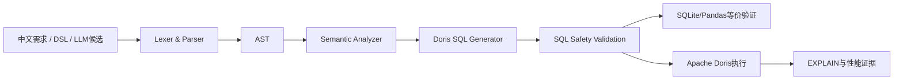

# FinDSL Forge 技术报告

## 摘要

FinDSL Forge 面向金融科技创新大赛赛题 19，构建了一个从金融选股 DSL 到 Apache Doris SQL 的确定性编译系统。系统支持复杂窗口函数、区间收益率、连续性判断、存在性判断、横截面排名、日期区间裁剪、多表指标 join 和 prefix-sum 长窗口优化，并提供自然语言到 DSL 的 AI 辅助入口。核心设计原则是：大模型可以辅助表达，但不能绕过编译器、语义检查和执行验证。

## 问题定义

金融选股条件经常包含多种复合逻辑，例如“连续 3 天主力净流入为正后按换手率排名前 100”、“近 120 日成交量累计大于阈值”、“指定日期区间内收盘价高于均线”、“近 2 日收盘价收益率超过 5%”。如果直接手写 SQL，业务人员难以维护；如果直接让 LLM 生成 SQL，又存在幻觉、不可审计和安全风险。因此本项目把业务表达收敛到 DSL，再由确定性编译器生成 Doris SQL。

## 总体架构

## 核心实现

- DSL 编译链路：`src/findsl/lexer.py`, `parser.py`, `semantic.py`, `sqlgen.py`。
- 配置化指标注册：`configs/indicators.json`, `configs/tables.json`, `src/findsl/registry.py`。
- 正确性验证：`reference.py`, `executor.py`, `equivalence.py`。
- Doris 部署：`deploy/doris/*.sql`, `deploy/doris/docker-compose.quickstart.yaml`。
- 性能证据：`doris_evidence.py`, `scripts/collect_doris_evidence.ps1`, `scripts/prepare_doris_scale_evidence.ps1`。
- AI 安全入口：`nl2dsl.py`, `llm_adapter.py`, `demo.py`。

新增的 `RET(value, n)` 算子将区间收益率定义为 `当前值 / n 个交易日前的值 - 1`，SQL 侧生成 `LAG` 特征并通过 `NULLIF` 防止除零，reference 侧使用 Pandas `groupby().shift()` 独立解释。该能力已经进入官方风格正例、负例诊断、NL2DSL 模板和 SQL/reference 等价验证。

## 优化方法

长窗口 `SUM(indicator, window)` 是核心性能瓶颈。baseline SQL 使用 `SUM(...) OVER (PARTITION BY ts_code ORDER BY trade_date ROWS BETWEEN N PRECEDING AND CURRENT ROW)`；优化路径把可前缀化指标映射到 prefix table，通过当前前缀值减去历史前缀值，或者在热点窗口上直接读取 materialized column，例如 `volume_sum_120`。这样减少了重复窗口计算，在 Doris 上形成清晰可解释的 EXPLAIN 差异。

## 实验设计

实验包含三层：

1. 小样本 correctness：SQLite SQL 执行结果与 Pandas reference 结果一致。
2. 官方风格覆盖：正例覆盖复杂 DSL，负例覆盖诊断和安全边界。
3. Doris 规模证据：本地 Docker Doris 载入 5,000,000 行行情数据，比较 baseline window 与 prefix-sum 优化 SQL 的 EXPLAIN、行数和执行耗时。
4. 真实行情小样本：使用东方财富公开 K 线数据验证真实股票代码、交易日期、收盘价、换手率和成交量字段下的 DSL 语义。

## 已验证结论

- 编译、SQL/reference 等价、官方风格套件和 demo smoke 均进入 readiness gate。
- Doris 5M 行证据证明 baseline 与 optimized 行数一致，优化路径包含 prefix table，baseline 包含 window path。
- 真实行情小样本证明 quote-only DSL 能在公开 A 股行情字段上通过同一套 SQL/reference 验证。
- LLM 安全环节拒绝直接 SQL 和错误 DSL，避免把不可审计 SQL 直接交给数据库。

## 竞争亮点

- 不是单纯 Demo，而是完整编译器、验证器、Doris 部署、性能证据和提交包自动化。
- AI 辅助被约束在 DSL 候选阶段，更适合金融风控和审计场景。
- prefix-sum 与 Doris 物理设计结合，提供真实集群证据，而不是只给理论优化。
- 所有核心指标由脚本生成，可回归、可复现、可回溯。

## 局限与后续

当前大规模性能证据使用确定性合成数据，适合复现实验；业务展示已补充东方财富公开行情小样本，但不把小样本用于性能结论。生产部署可进一步扩展为多 BE 集群、Routine Load、物化视图维护、真实资金流数据和更多财务/新闻情绪指标。
